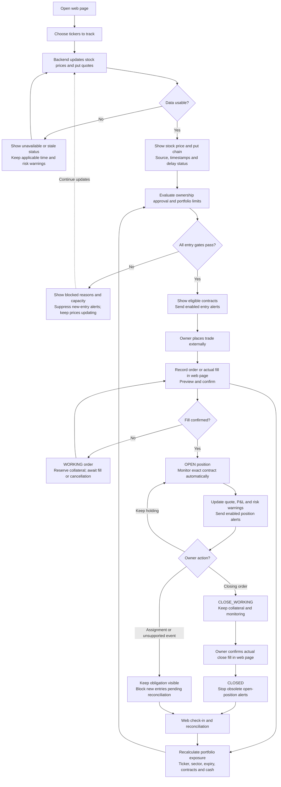

# CSP Alerts — visual workflow

Required target workflow; not a claim of completed implementation. Read the [owner workflow](CSP_ALERTS_WORKFLOW.md) and [product requirements](PRODUCT_WORKFLOW_REQUIREMENTS.md).

- Market-data updates and existing-position monitoring continue when entry gates block new opportunities. Watching a ticker does not approve it for entry alerts.
- “Usable” follows the documented evidence policy; recently retrieved indicative data is not guaranteed live. Show stock and option timestamps separately.
- Owner execution occurs outside the app. Web actions record reality, never submit orders. Recorded trades remain visible even if they breach limits.
- Reserve collateral for pending/working/open/close-working obligations; reconcile before treating released capacity as verified. Cancellation of an unfilled order is recorded and reconciled through the same web workflow.
- Portfolio limits retain $15K pilot collateral, $9K per ticker, $10K per sector, four active contracts and every other existing gate. Never suppress existing-position risk warnings just because entries are blocked.
- Backend jobs continue with the browser closed while the PC and jobs are running. Telegram delivery requires explicit enablement. Final exit thresholds remain an owner decision.

Acceptance remains pending under WT-AT-01..10 and MD-AT-01..06. [Current status](OPEN_ISSUES.md).
